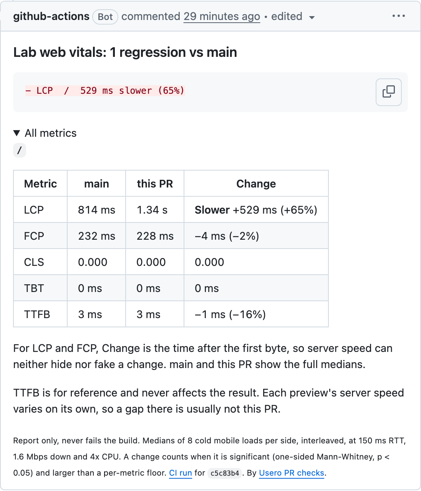

# Usero PR checks

A GitHub Action that loads your pull request's preview and your main branch's preview back to back, in the same job, and
measures lab web vitals (LCP, FCP, CLS, TBT, optionally INP) and server time on both. A significance test decides what
changed, and one PR comment reports only the changes larger than run-to-run noise. It never fails your build unless you ask
it to.



This is a pre-release. Inputs may change before v1, so pin `@v0` and check the release notes when you update.

## Quick start

You need a preview URL for each PR and one for main. Add this job after the job that deploys the PR preview:

```yaml
  web-vitals:
    needs: deploy-preview
    runs-on: ubuntu-latest
    permissions:
      contents: read
      actions: read
      pull-requests: write
    steps:
      - uses: usero-feedback/pr-checks@v0
        with:
          head-url: https://pr-${{ github.event.number }}.my-app.example.com
          base-url: https://main.my-app.example.com
          paths: / /pricing
```

That is the whole setup. The first run posts a comment on the PR. A later push with the same verdict edits that comment in
place, quietly; a push that changes the verdict (a new regression, the last one fixed, or a different set) posts a fresh
comment and deletes the old one, because GitHub only sends email for new comments. The full result is also in the job
summary.

Recipes for common hosts are below: [Cloudflare](#cloudflare-workers-and-pages), [Vercel](#vercel),
[Netlify](#netlify) and [sites you can serve inside the job](#serve-both-builds-inside-the-job).

Each test load is a real page view on the URLs you give it, analytics included. See [Analytics](#analytics) before you point
it at a site that reports to your production analytics.

## What it reports

The comment is built to be read in a notification email on a phone: the answer first, everything else folded.

- The title states the result: "no significant change vs main", "1 regression vs main", "2 regressions, 1 improvement vs
  main".
- Under it, a `diff` block with one line per change: slower on a red `-` line, faster on a green `+` line, and the word
  "slower" or "faster" on every line, so it reads the same in an email where colour is gone. A quiet run has no block.
- Pages or metrics that main or the PR could not measure (a preview that 500s, an LCP the page never reported) are listed
  right under it, since a gap there can hide a regression.
- Everything else is in one fold, open when something changed: a trend chart for each page that changed (main's last 20
  runs as a line, this PR as one orange dot beside it, from the third run on, see [Trend chart](#trend-chart)), then a
  four-column table per page (metric, main, this PR, change), with prod's medians on one line under it. Only significant
  rows say Slower or Faster.
- Rows that add nothing are left out: CLS, TBT or Server reading zero on both sides, and FCP when it matches LCP within
  100 ms on both sides with the same verdict (a page whose largest paint is its first). Such an FCP is not counted twice in
  the title or the `regressions` output either.
- Server time is judged like the rest, in its own Server row: a slow query or an extra database round trip in a PR is a
  regression. When it regresses and your server sends a `Server-Timing` header, its database time and query count show
  under the row, see [Server time](#server-time).
- One footer line: "Report only", a link to [Method](#method), and the CI run.

The [demo repository](https://github.com/usero-feedback/pr-checks-demo/pulls?q=is%3Apr) has a PR with a deliberate slow hero
image and a PR that changes nothing, with the comment this action posted on each.

## Inputs

| Input                | Default               | What it does                                                                                                                              |
| -------------------- | --------------------- | ----------------------------------------------------------------------------------------------------------------------------------------- |
| `head-url`           | required              | The PR's preview URL.                                                                                                                     |
| `base-url`           | required              | What to compare against, usually main's preview. The comment calls it "main". Any path on the URL is kept, so `https://x.dev/app` works. |
| `prod-url`           |                       | Your production URL. Its medians are shown on one line under each page's table (each page in `prod-paths`), for reference, and never change the result. Its loads are real production visits. |
| `paths`              | `/`                   | Pages to measure. One per line, or separated by spaces or commas.                                                                        |
| `prod-paths`         | every path            | Which of `paths` also load `prod-url`, in the same format. Leave out a page that does not exist on production (one seeded only on previews, say): it gets no prod loads and no prod line. Naming a path not in `paths` is a setup error. |
| `rounds`             | `8`                   | Rounds per page, 3 to 50. Each round loads main and the PR once, in alternating order.                                                   |
| `server-samples`     | `30`                  | Server time requests per side and page, 10 to 200, or `0` to turn server time off. See [Server time](#server-time).                      |
| `device`             | `mobile`              | `mobile` (Lighthouse's Slow 4G and 4x CPU profile) or `desktop`.                                                                         |
| `interact`           |                       | INP measurement: one `PATH::SELECTOR` per line, clicked after load. Without it INP is not reported.                                      |
| `headers`            |                       | Extra request headers, one `Name: value` per line, sent only to the head, base and prod sites, and with the server time requests.       |
| `github-token`       | `${{ github.token }}` | Finds the PR, posts the comment and reads past runs for the trend chart.                                                                  |
| `comment`            | `true`                | Post or update the PR comment. The job summary is written either way.                                                                     |
| `pr-number`          | from the event        | The PR to comment on. Found from the event or the commit; set it for `workflow_dispatch` runs.                                           |
| `fail-on-regression` | `false`               | Fail the job when anything regressed.                                                                                                     |
| `base-bundle-bytes`  |                       | main's server bundle size in bytes, shown with `head-bundle-bytes` as the change cold starts pay for. Never judged.                       |
| `head-bundle-bytes`  |                       | This PR's server bundle size in bytes.                                                                                                   |
| `chart-base-url`     | usero.io              | Where the trend chart images are drawn. Only for testing a chart server.                                                                 |

| Output         | What it holds                                                                                              |
| -------------- | ---------------------------------------------------------------------------------------------------------- |
| `regressions`  | Number of significant regressions vs main.                                                                 |
| `improvements` | Number of significant improvements vs main.                                                                |
| `json-path`    | `vitals.json` with every raw sample and the summary. The action also saves it as an artifact (see below). |

The job fails only on a setup mistake (a missing or invalid input, or no Chrome on the runner), so a first install shows
what to fix. A preview that is down or a load that times out is reported in the comment and the job still passes.

## Trend chart

Every run saves its `vitals.json` as a workflow artifact named `usero-pr-checks-<device>-<hash of base-url>`, kept for
your repository's artifact retention (90 days by default). The next run lists those artifacts with the job's token (this
is why it needs `actions: read`), downloads up to 20 of the newest, and takes main's median per page and metric from each.
This run's main is the newest point. Runs on another device or base URL are never mixed in.

- The chart appears once three runs have a value, so the first two runs of a new setup have none.
- No history, no permission or a GitHub API error means no chart, never a failed step. The log says which, in one line.
- The image is drawn by usero.io from its URL, which holds the metric, the page path and the rounded medians, nothing else:
  no repository name, no site address, no token. GitHub fetches it once through its image proxy and caches it.
- Reading history runs while the pages load, so it adds no time to the job.

## Server time

Before any page loads, the action sends plain GET requests (no browser, no throttling) to each path on main and the PR,
alternating main and PR: 10 per side on a new connection each, then 5 kept-alive connections per side that each get one
warm-up request, then `server-samples` (30) per side rotating over those 5. The measured ones are timed from sending the
request to the first byte of the response, with connection setup left out, so it is the server's work plus one network
round trip from the runner. Rotating matters: a connection stays on one server machine, and with a single connection
per side two deployments of the same Usero code read 34 to 58 ms apart, most likely one machine against another.
The requests use the mobile browser's user agent and your `headers`.

- **Cold starts are reported apart, not judged.** On serverless hosts a request that lands on a cold instance pays its
  start-up (loading and evaluating the server bundle), and at low traffic that is most first visits. New connections are
  the likeliest way to reach one, which is why they come first. A request counts as cold when the server says so in
  `Server-Timing` (`isolate;desc=cold`, below), or without that marker when it is slower than 3x the side's warm median and
  300 ms over it. A line under the Server row shows each side's median cold first byte and how many requests were cold,
  for example `cold start 1.02 s to 1.51 s (4 and 2 of 43), not judged`. A run gets a handful at best, so it is measured,
  not judged, and cold requests never count in the Server row.
- **Bundle size.** Pass `base-bundle-bytes` and `head-bundle-bytes` and the comment shows both and the change: a bigger
  server bundle is the most common way a PR makes cold starts slower, since a cold start loads and evaluates it. Not judged.

- **The Server row is judged** like LCP or TBT (the test is under [Method](#method)), so a PR that adds a slow query, an
  extra database round trip or slow rendering on the server gets a regression on its own line. LCP and FCP are judged from
  the first byte, so the same slowdown is never counted twice.
- **Cold requests among the measured ones** are left out of the Server row's test. Without the marker, at most 10% of a
  side's measured requests can be left out this way; more than that is how the server behaves, so they stay in.
- **Why not the page loads' TTFB.** Each page load opens a fresh connection in a fresh browser context, and on serverless
  previews that first byte flips between about 0.1 s and 1.3 to 1.9 s for minutes at a time (most likely new connections
  landing on cold isolates). In A/A runs a verdict on it fired 63 to 73% of the time. Warm requests on kept-alive connections do not
  see that, and 30 of them per side cost a few seconds. The page loads' TTFB stays in `vitals.json` but not in the comment.

### Server-Timing (optional)

If your server sends a [`Server-Timing`](https://developer.mozilla.org/en-US/docs/Web/HTTP/Headers/Server-Timing) header
on HTML responses, the action reads four things from it:

```
Server-Timing: total;dur=182.4, db;dur=41.7;count=6, isolate;desc=warm
```

| Metric             | Meaning                                                                                                     |
| ------------------ | ----------------------------------------------------------------------------------------------------------- |
| `total;dur=<ms>`   | Time spent in your handler, up to the response headers. When every request on both sides has it, the Server row tests `total` instead of the first byte, which leaves the network out. |
| `db;dur=<ms>`      | Database time. Shown under the Server row as main's and the PR's medians.                                   |
| `db;count=<n>`     | Number of queries, shown next to it. Several `db` entries are summed, and without `count` each entry counts as one query. |
| `isolate;desc=cold` or `warm` | `cold` on the first request a server instance (isolate, lambda, process) handles, `warm` after. Decides which requests count as cold starts. A module-level counter is enough. |

Other metrics in the header are ignored, and a page without the header (a prerendered or static page) is measured from its
first byte like any other. Only send `total` if it covers CPU time too: on Cloudflare Workers the clock stops
between I/O events, so a `total` there leaves out rendering and a CPU-heavy regression would read as no change. Send only
`db` there, and the row keeps testing the first byte. The header is visible to anyone who loads the page, so you can limit
it to preview deployments, which is where this action measures.

## Recipes

Every recipe measures the PR preview against a preview of main built the same way. Comparing against production would mix
in its warm caches, real data and different third-party tags. Pass production as `prod-url` if you want it in the table.

### Cloudflare Workers and Pages

**Workers with a preview per PR.** If your deploy job uploads a preview Worker or a preview alias per PR, its URL is
predictable from the PR number. Run the check after that job:

```yaml
on: pull_request

jobs:
  deploy-preview:
    # your existing job, for example: npx wrangler versions upload --preview-alias pr-${{ github.event.number }}
  web-vitals:
    needs: deploy-preview
    runs-on: ubuntu-latest
    permissions:
      contents: read
      actions: read
      pull-requests: write
    concurrency:
      group: web-vitals-${{ github.event.number }}
      cancel-in-progress: true
    steps:
      - uses: usero-feedback/pr-checks@v0
        with:
          head-url: https://pr-${{ github.event.number }}-my-worker.my-account.workers.dev
          base-url: https://main-my-worker.my-account.workers.dev
          paths: / /docs
```

Cloudflare does not send GitHub deployment events, so the check has to run in the same workflow, after the deploy.

**Pages deployed from Actions.** `cloudflare/wrangler-action` returns the deployment URL as an output:

```yaml
      - id: deploy
        uses: cloudflare/wrangler-action@v4
        with:
          apiToken: ${{ secrets.CLOUDFLARE_API_TOKEN }}
          command: pages deploy dist --project-name=my-site --branch=${{ github.head_ref }}
      - uses: usero-feedback/pr-checks@v0
        with:
          head-url: ${{ steps.deploy.outputs.deployment-url }}
          base-url: https://main.my-site.pages.dev
```

`https://main.my-site.pages.dev` is the alias of the latest deploy from the `main` branch. If main is your production
branch, use `https://my-site.pages.dev` as `base-url` instead, and read [Analytics](#analytics) first.

### Vercel

Vercel reports each deployment to GitHub, so the check can start when a preview is ready:

```yaml
on: deployment_status

jobs:
  web-vitals:
    if: github.event.deployment_status.state == 'success' && github.event.deployment_status.environment != 'Production'
    runs-on: ubuntu-latest
    permissions:
      contents: read
      actions: read
      pull-requests: write
    steps:
      - uses: usero-feedback/pr-checks@v0
        with:
          head-url: ${{ github.event.deployment_status.environment_url }}
          base-url: https://my-app-git-main-my-team.vercel.app
          headers: |
            x-vercel-protection-bypass: ${{ secrets.VERCEL_AUTOMATION_BYPASS_SECRET }}
            x-vercel-set-bypass-cookie: true
```

- `deployment_status` events carry a commit but no PR number, so the action finds the open PR for that commit itself.
- `base-url` is the branch URL of `main` (`<project>-git-main-<team>.vercel.app`). Your production URL works too, with the
  caveats above.
- With Deployment Protection on, create a secret under Project Settings, Deployment Protection, Protection Bypass for
  Automation, and store it as a repository secret. The headers are sent only to the preview and base URLs, never to third
  parties.
- On a monorepo, Vercel names the environment per project (for example `Preview – web`), so filter on that if several
  projects deploy from one repo.

### Netlify

Netlify does not send GitHub deployment events, but its commit status for a deploy preview links to the preview:

```yaml
on: status

jobs:
  web-vitals:
    if: >-
      github.event.state == 'success' &&
      startsWith(github.event.context, 'netlify/') && endsWith(github.event.context, '/deploy-preview')
    runs-on: ubuntu-latest
    permissions:
      contents: read
      actions: read
      pull-requests: write
    steps:
      - uses: usero-feedback/pr-checks@v0
        with:
          head-url: ${{ github.event.target_url }}
          base-url: https://main--my-site.netlify.app
```

`https://main--my-site.netlify.app` is the branch deploy of `main`; turn on branch deploys for `main` in Netlify, or use your
production URL. The `status` event runs the workflow file from your default branch, so merge it before testing on a PR.
If the status on your commits links somewhere other than the preview, set `head-url` to
`https://deploy-preview-<number>--my-site.netlify.app` and `pr-number` to the PR instead.

### Serve both builds inside the job

A static site, or any build you can serve locally, needs no preview host. Build main and the PR in the job, serve each on its
own port and compare them. The browser applies the mobile network and CPU throttling, so local pages still load like they
would on a phone. Nothing here needs a secret, so pull requests from forks are measured too (their result goes to the job
summary, see [forks](#permissions-and-pull-requests-from-forks)).

```yaml
on: pull_request

jobs:
  web-vitals:
    runs-on: ubuntu-latest
    permissions:
      contents: read
      actions: read
      pull-requests: write
    steps:
      - uses: actions/checkout@v7
        with: { ref: '${{ github.event.pull_request.base.sha }}', path: base }
      - uses: actions/checkout@v7
        with: { ref: '${{ github.event.pull_request.head.sha }}', path: head }
      # Build both here if your site needs it (npm ci && npm run build in each folder).
      - run: |
          nohup python3 -m http.server 8001 --bind 127.0.0.1 --directory base/site > /dev/null 2>&1 &
          nohup python3 -m http.server 8002 --bind 127.0.0.1 --directory head/site > /dev/null 2>&1 &
          sleep 2
      - uses: usero-feedback/pr-checks@v0
        with:
          head-url: http://127.0.0.1:8002
          base-url: http://127.0.0.1:8001
```

The [demo repository](https://github.com/usero-feedback/pr-checks-demo) runs this setup; its
[workflow](https://github.com/usero-feedback/pr-checks-demo/blob/main/.github/workflows/pr.yml) is a complete example.
A static file server answers in about a millisecond, so the Server row only moves when the server you start does real work
per request. The demo's small server does, and its PR #4 makes it 300 ms slower.

## Analytics

The action loads every page as a visitor's browser would. Nothing is blocked or faked: analytics, RUM and session replay
scripts load, run and send their data, so a heavy or slow tag shows up in the numbers like any other regression.

- Point your previews at a test analytics environment (a separate GA4 property, a staging project in PostHog or Sentry, a
  test key for your RUM tool), the same way you keep preview data out of your production database. The test loads land
  there instead of in your real numbers.
- A run sends 2 warm-up loads plus `rounds` x 2 loads per path to the previews: 18 page views for one path at the defaults.
  Server time adds 45 plain GETs per side and path (10 on new connections, 5 warm-up, `server-samples` measured) that run
  no page scripts, so only server-side analytics count them.
- `prod-url` loads are real visits to production and send real hits to your production analytics (3 per path in
  `prod-paths` per run). Leave `prod-url` out if that matters.
- The loads use an ordinary Chrome user agent from GitHub's runner IPs, so they are hard to filter out afterwards. A test
  analytics environment is the dependable fix.

## Permissions and pull requests from forks

- The comment needs `pull-requests: write`, and the trend chart needs `actions: read` to find earlier runs. Repositories
  created after February 2023 default to a read-only token, so add the `permissions` block from the quick start. Without
  `actions: read` the comment has no chart and the log says why; nothing else changes.
- A pull request from a fork gets a read-only token and no secrets. The action still measures (if a preview exists for
  the fork), writes the result to the job summary and skips the comment with one line in the log saying why. It never fails
  the job for this.
- Do not switch to `pull_request_target` to get a write token for forks unless you understand the risk: it runs untrusted
  code with your secrets.

## Run time

A load takes 2 to 10 seconds at the mobile profile, depending on the page. A run is 2 warm-up loads plus, per path,
`rounds` x 2 loads, plus 3 loads per path in `prod-paths` when `prod-url` is set. Server time comes first and takes seconds: 90 requests
per path at your server's speed, plus a second or so for each cold start it meets. With the default 8 rounds on one path, the action took
52 s on the demo's one-page static site and 93 s on a small marketing site's home page. On Usero (pages of about 1 MB) 8
rounds on two paths with prod took 6.5 to 7 minutes.

Set `timeout-minutes` on the job, and add a `concurrency` group (as in the Cloudflare recipe) so a new push cancels the old
run.

The action uses the Google Chrome that GitHub's hosted runners already have, so there is no browser download. On a
self-hosted runner or in a container without Chrome, add `browser-actions/setup-chrome@v2` before it and pass its path as
the `CHROME_BIN` environment variable.

## Method

**Each load is cold.** A fresh browser context per load (empty cache, no cookies, no service worker) in one headless Chrome.
The mobile profile is Lighthouse's: Moto G Power viewport, 150 ms latency, 1.6 Mbps down, 750 Kbps up and 4x CPU slowdown,
applied through the Chrome DevTools Protocol. Chrome applies that latency to every request except the HTML document itself,
so TTFB is the server's real response time. Absolute numbers are not PageSpeed scores (DevTools throttling is gentler per
request than Lighthouse's, and 4x on a shared CI runner is slower than 4x on a laptop). The action only compares two sides
measured the same way in the same job.

**Metrics** come from Google's [web-vitals](https://github.com/GoogleChrome/web-vitals) library, injected before any page
script. After the page settles the action fires the page-hidden event, the same signal web-vitals uses to finalise LCP, CLS
and INP in a real tab. TBT follows Lighthouse (each long task's time over 50 ms, from FCP to the end of the load), cut off
at load plus settle, so it covers the loading phase only. INP needs a real interaction, so it is only measured with
`interact`, never estimated.

**Interleaved rounds.** One discarded warm-up load per preview wakes cold servers. Then each round loads main and the PR
once, alternating which goes first, so slow drift on the runner lands on both sides equally. Prod, when given, gets 3 loads
spread over the rounds.

**The test.** Per page and metric, the PR is compared with main by a one-sided Mann-Whitney U test in each direction (exact
up to 80 samples, ties included) and a Hodges-Lehmann shift with its confidence interval. A change counts when p < 0.05
**and** the shift clears a floor:

| Metric   | Floor (the larger of)                 | Why                                                                  |
| -------- | ------------------------------------- | -------------------------------------------------------------------- |
| LCP, FCP | 100 ms or 5% of main, from first byte | Below about 100 ms nobody notices.                                   |
| TBT      | 50 ms or 20%                          | Long-task time is the noisiest lab metric; only big shifts are real. |
| INP      | 25 ms or 20%                          | One scripted click per load; small moves are frame timing noise.     |
| CLS      | 0.01                                  | Lab CLS is nearly deterministic, so any visible shift counts.        |
| Server   | 75 ms or 10% of main                  | Two deployments of the same code differed by up to 58 ms warm.       |

**Paint is measured from the first byte.** LCP and FCP are tested as each load's value minus its TTFB, or minus the moment
the page's first script could run when that is later: a server that answers in a millisecond beats the browser's own
start-up by about 200 ms, and without this a 300 ms slower server read as 160 ms faster paint on the demo. Preview servers
switch between fast and slow first bytes for minutes at a time, on their own, and that used to swamp real paint changes. The
table's main and this PR columns still show the full medians, and Change shows the time after the first byte, so the two
can disagree: when the first byte moved by more than the floor, a line under the first paint row says so, for example
`first byte +312 ms, not counted`. Server time has its own row, measured on warm connections (see
[Server time](#server-time)), so a server slowdown counts once, there.

**prod is for reference only.** Its medians sit on one line under each page's table and never change a verdict. Production
can load third-party tags, real data and warm caches that the previews do not, so a gap between prod and the PR is usually
not the PR.

**A failed load** (an HTTP error, a timeout) is recorded with its reason and left out of the stats. A metric needs at least 3
good loads per side to be compared.

### Detection power

Measured on GitHub's ubuntu runners against a real app's previews (Usero, pages of about 1 MB with an LCP near 4 s), 24
rounds per page scored in 1000 random subsets of 8 rounds, with known regressions injected:

| What happened                          | Caught, on two pages |
| -------------------------------------- | -------------------- |
| Nothing (A/A): a false verdict         | 0%, 0%               |
| +300 ms LCP                            | 99%, 100%            |
| +500 ms LCP                            | 100%, 100%           |
| +150 ms TBT                            | 97%, 100%            |
| +500 ms server delay, as an LCP change | 0%, 0% (by design)   |

The last row is expected: paint is measured from the first byte, so a slower server counts in the Server row instead.
Smaller pages have smaller floors, so smaller changes can count. On the demo's
static page a heavier hero image (+107 KB) came out as +531 ms LCP and was flagged.

**Server time** was measured the same way on 2026-10-12 with `npm run power` (`scripts/power-server.ts`): on a GitHub
runner, 15 runs per page, each the action's warm sampling (5 kept-alive connections per side with one warm-up each, then
30 requests per side rotating over them), against Usero's main preview as main and, as the PR, either the same preview or a
second deployment of the same code with its own Worker and database. Every side goes through a local proxy that keeps one
upstream connection per incoming one, and the injected rows hold the PR's responses for 100 or 300 ms. Each cell is runs
with the verdict, then the rate over 1000 runs resampled from all rounds, at the 75 ms floor:

| `/` then `/docs`               | main against main                | main against a second deployment |
| ------------------------------ | -------------------------------- | -------------------------------- |
| Nothing (A/A): a false verdict | 0 of 15, 0 of 15 (0%, 0%)        | 0 of 15, 0 of 15 (0%, 0%)        |
| +100 ms server time caught     | 15 of 15, 13 of 15 (99.6%, 99.9%) | 10 of 15, 13 of 15 (74%, 88%)   |
| +300 ms server time caught     | 15 of 15, 15 of 15 (100%)        | 15 of 15, 15 of 15 (100%)        |

The second deployment answered 25 ms (`/`) and 16 ms (`/docs`) faster than main's with the same code, so its +100 ms read
as about +75 ms and +81 ms, right at the floor: that is the column a real PR sits in, and +100 ms there is caught about
three times in four. An earlier version used one connection per side and saw two deployments 34 to 58 ms apart on `/`
(Usero PR #297; with the then 50 ms floor the first of those read as 58 ms faster), which is why the floor is 75 ms and the
requests rotate. Warm medians per run stayed within 96 to 167 ms on `/` and 62 to 100 ms on `/docs`. The preview first-byte
swings that made page-load TTFB useless (0.1 s against 1.3 to 1.9 s) did not show up on warm connections; on new
connections they did, as cold starts (1.3 to 2.9 s), which is what the cold start line reports. On the demo, a server 300 ms
slower per page was flagged (PR #4). Neither Usero page queries its database for an anonymous visitor, so these runs cover
rendering and the network, not query time.

## Limits

- This is a lab test on a shared CI machine. It catches changes a PR makes to how a page loads and does not predict your
  field Core Web Vitals.
- Previews differ from production: cold servers, small databases, cold CDN caches. The verdict compares preview with preview,
  so both sides share those conditions.
- Pages behind a login are not supported yet. `headers` can pass a static token if your preview accepts one.
- With 8 rounds a change under the floor can slip through, which is why a clean run says "no significant change" rather
  than "no change". More rounds narrow that gap and take longer.
- Chrome only.

## License

MIT

Made by [Usero](https://usero.io/?utm_source=github&utm_medium=pr-checks), the direct line from user to engineer.
